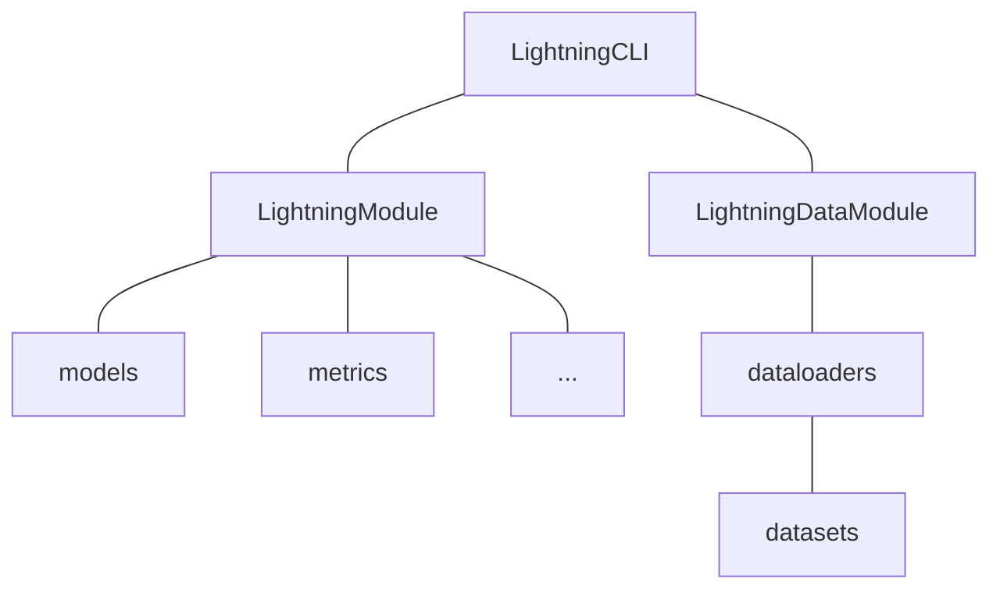

# Development Guide

Notes on the codebase layout, configuration system, and environment for contributors. For installation, checkpoints, inference, and training, see the main [README](../README.md).

## Project Architecture

The project is built on [PyTorch Lightning CLI](https://lightning.ai/docs/pytorch/stable/cli/lightning_cli.html):



## Repository Structure

```text
├── anonymization            # Pseudo-speaker generation (GAN, pool, random anonymizers)
├── ckpts                    # Checkpoints and k-means models
├── configs
│   ├── data                 # Data module configs (pasr.yaml, resynthesis.yaml)
│   ├── model                # Model configs (mimipasr_*, mimiresynthesis_*, ...)
│   └── default.yaml         # Trainer, logger, and callback defaults
├── notebooks                # Inference notebooks (DarkStream and SLT24)
├── preprocess               # Content feature extraction for k-means training
├── sample_wav               # Sample utterances for testing
├── scripts                  # Utility scripts
├── src
│   ├── callbacks            # Lightning callbacks
│   ├── components           # Building blocks: SEANet, transformer, streaming, losses, quantizers
│   ├── data_modules         # LightningDataModules (PASR, resynthesis)
│   ├── metrics              # Evaluation metrics (e.g., UTMOS, periodicity)
│   ├── models               # Encoders and decoders (Mimi-style and HiFi-GAN-style)
│   ├── modules              # LightningModules for each training stage and variant
│   ├── utils                # CLI and helpers
│   └── main.py              # Training entry point
├── .env.example             # Example environment variables
├── LICENSE
├── README.md
└── requirements.txt
```

## Adding a Model or Dataset

1. Define a dataset by subclassing `pl.LightningDataModule` in `src/data_modules`.
2. Add a data config in `configs/data` with the data module's parameters.
3. Define the network by subclassing `nn.Module` in `src/models`.
4. Define metrics by subclassing `torchmetrics.Metric` in `src/metrics`.
5. Define the training module by subclassing `pl.LightningModule` in `src/modules`.
6. Add a model config in `configs/model` with the training module's parameters.
7. Configure the trainer, logging, and other options in `configs/default.yaml`.

## CLI Tips

### Printing the resolved config

`jsonargparse`'s `--print_config` prints the parsed arguments, which is useful for generating a full config file:

```bash
python src/main.py fit -c configs/data/pasr.yaml -c configs/model/mimipasr_la7.yaml --print_config
```

See [Prepare a config file for the CLI](https://lightning.ai/docs/pytorch/stable/cli/lightning_cli_advanced.html#prepare-a-config-file-for-the-cli).

### Custom `LightningCLI`

`CustomLightningCLI` extends the default CLI as follows:

- Saves the config file to the log directory at startup (`WandbLogger` only).
- Logs optimizer and scheduler configurations.
- Loads `configs/default.yaml` automatically.
- Prints the `checkpoint_path` used after testing.
- Adds command-line options:
    - `--ignore_warnings` (default: `False`): ignore all warnings.
    - `--test_after_fit` (default: `True`): test the best checkpoint after training.
    - `--git_commit_before_fit` (default: `False`): run `git commit` before training, with the message `{logger.name}_{logger.version}` (`WandbLogger` only).

See [Configure hyperparameters from the CLI (expert)](https://lightning.ai/docs/pytorch/stable/cli/lightning_cli_expert.html).

## Environment Tips

### Limiting NumPy threads

On machines with many CPU cores (≥24), too many NumPy threads can make training hang. Limit them in your `.env` file:

```text
OMP_NUM_THREADS=8
MKL_NUM_THREADS=8
GOTO_NUM_THREADS=8
NUMEXPR_NUM_THREADS=8
OPENBLAS_NUM_THREADS=8
MKL_DOMAIN_NUM_THREADS=8
VECLIB_MAXIMUM_THREADS=8
```

The `.env` file is loaded automatically by [`pyrootutils`](https://github.com/ashleve/pyrootutils) via [`python-dotenv`](https://github.com/theskumar/python-dotenv).

### Clearing the `wandb` cache

Deleting a run on the wandb website leaves its cache in the local `wandb` directory. Run `scripts/clear_wandb_cache.py` to remove it.
